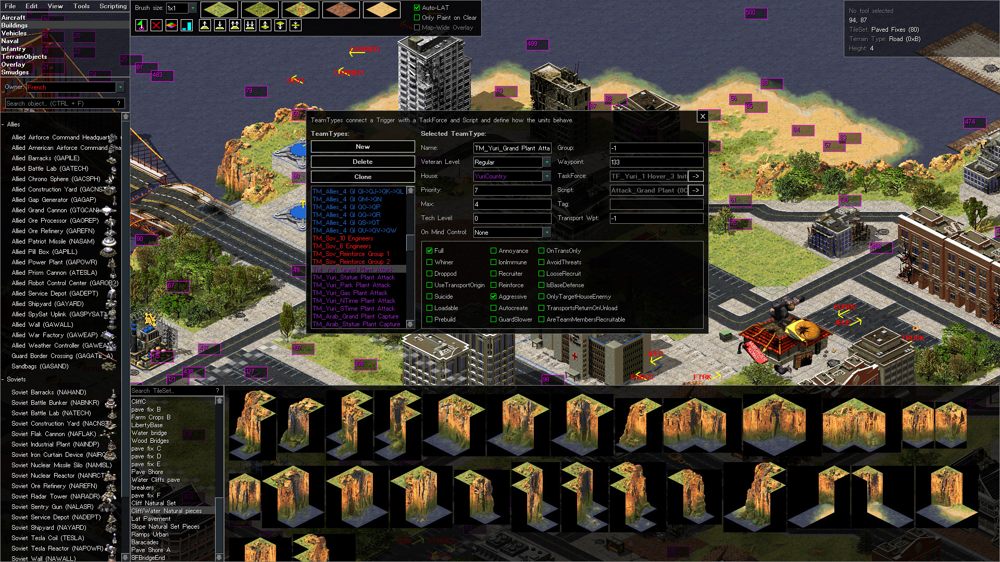

  

  
  
  

  Modern open-source map and scenario editor for Command & Conquer: Red Alert 2, Command & Conquer: Tiberian Sun and the <a href="https://www.moddb.com/mods/the-dawn-of-the-tiberium-age">Dawn of the Tiberium Age</a> mod.

## About

The World-Altering Editor is a new map editor for the second-generation classic Command & Conquer games,
designed to replace the old FinalSun/FinalAlert2 (FS/FA2) map editor developed in the TS/RA2 modding community in the early 2000s.

To make it familiar for existing mappers, the editor is designed to follow the FS/FA2 UI design,
but with modernizations and changes to make the editor smoother and more efficient to use.

Check out the [user manual](docs/Manual.md) for advanced tips and tricks for mapping with WAE.

## State of the project

The editor includes practically all tools present in FS/FA2 and a significant number of
new ones. Many familiar tools have been improved with significant quality-of-life improvements.
These improvements make it much more efficient to create maps with WAE than the old FS/FA2 map editors.

New functionality and helpful features are being constantly added to make the mapping experience smoother and more efficient.
Some examples include a zoom function, lighting preview, a much improved trigger editor interface, and a terrain generator for rapid detailing of large areas.

## System requirements

WAE is graphically more demanding than FS/FA2, but can also utilize modern hardware
much more efficiently, meaning that if you have a decently modern computer, WAE achieves smoother
performance with better graphical quality.

To run WAE, you need the following

- .NET 8 Desktop Runtime
- DirectX11 compatible GPU\*. At least 2 GB of VRAM is recommended, although WAE can run on less.
- 64-bit system. If you absolutely need a 32-bit build, you can modify the source to produce one.

\* Some Intel GPUs, such as HD Graphics 4000, are known to have driver issues that prevent them from running WAE. It is recommended to have an AMD or Nvidia GPU for WAE, but newer Intel GPUs can also work.

## Downloads

For most end-users, it is recommended that you download our latest official release: https://github.com/CnCNet/WorldAlteringEditor/releases

Development builds are available through our automated build workflow which is run whenever new commits are pushed. You can download the editor from the build artifacts:
https://github.com/CnCNet/WorldAlteringEditor/actions

If you are mapping for Dawn of the Tiberium Age, the editor is bundled with the mod.

## Contributing

We gladly accept contributions as long as they are well made and we deem them as beneficial for a significant part of the editor's userbase.

Follow the [contribution guidelines](docs/Contributing.md) when creating pull requests.

## License

The editor is licensed under the GNU General Public License, version 3.
If you create and publish a derivate, you need to also release your source code for the fork.
Please see LICENSE.txt for more details.

EA has not endorsed and does not support the World-Altering Editor.

## Screenshot

## Introduction video

The World-Altering Editor was originally developed by the Dawn of the Tiberium Age staff for their mod. TS and YR support were added later to offer a boost in mapping efficiency to the rest of the second-generation C&C community.

